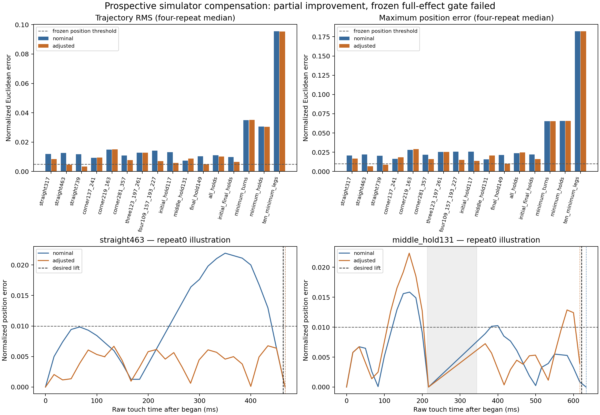

# Prospective simulator compensation: partial gain, frozen gate failed

The legal compensation prototype **failed its prospective overall gate**.
Across sixteen unseen commands, mean trajectory RMS fell from **0.019443 to
0.016609 normalized units (14.58%)**, below the frozen 25% requirement.
Only **2/16** adjusted commands passed the combined position, waypoint-arrival,
hold-boundary and release criteria, versus 0/16 nominal commands. Those two were
463 ms and 739 ms straight paths. This is an unsuccessful general compensator,
with useful restricted straight-path gains. No production change follows.

## Frozen construction and measurement

[FROZEN.json](FROZEN.json) fixes four development and sixteen held-out desired
paths, all forty exact payloads, candidate source hash, thresholds and order seed
before any action request. [PLAN-FROZEN.md](PLAN-FROZEN.md) specifies the split,
failure rules and request cap. The newly constructed paths cover straight legs,
sharp corners, unequal durations, initial/middle/final zero-distance holds,
combined holds, three 100 ms minimum intervals and ten 100 ms intervals.
Previous 1,090-request measurements supplied development information only.

The prototype in [study.py](study.py) enumerates legal subdivisions, chooses
integer durations using the prior approximate ceiling-clock model, and refits
added points along their original straight legs using least squares. It fixes
semantic corners/hold positions and first/last endpoints. Each emitted command
passes the existing `Gesture` and `TimedWaypoints.payload()` checks: at most ten
intervals, each at least 100 ms, total 300–1200 ms, one contact, integer coordinate
compilation and unchanged protected-control safety checks. There is no W3C pause
substitution or relaxed minimum. Fifteen of twenty payloads change; the five
unchanged outputs are explicitly **constrained fallbacks**, not compensation.

The full-effect gate requires four-repeat median normalized RMS≤0.005,
maximum error≤0.01 and all waypoint/hold/release absolute errors≤17.667 ms,
plus all sixteen held-out cases passing and at least25% macro RMS improvement.
These research diagnostics do not replace or relax the collection protocol.

**160/160 measurements and two isolated setup smokes completed once**, with no
automatic retries. All attempts were logged before dispatch. Order was randomized
across command, variant and four repeats. The candidate was not retuned on either
development or held-out measurements. An independent source/hash audit confirms
the frozen source and all forty payloads remain unchanged and recompile identically.

## Results beyond total duration

| Held-out case | Nominal RMS | Adjusted RMS | Adjusted lift error ms | Full pass |
|---|---:|---:|---:|:---:|
| straight317 | .01197 | .00844 | −.333 | No |
| straight463 | .01269 | .00454 | +3.667 | Yes |
| straight739 | .01169 | .00340 | −5.667 | Yes |
| corner137_241 (fallback) | .00927 | .00954 | +21.750 | No |
| corner219_163 | .01484 | .01502 | +1.333 | No |
| corner281_357 | .01093 | .00777 | −4.667 | No |
| three123_197_261 (fallback) | .01284 | .01284 | +19.000 | No |
| four109_157_193_227 | .01415 | .00702 | −2.667 | No |
| initial_hold117 | .01319 | .00580 | +7.334 | No |
| middle_hold131 | .00734 | .00880 | −4.334 | No |
| final_hold149 | .01041 | .00495 | +3.334 | No |
| all_holds | .01100 | .01023 | −8.333 | No |
| initial_final_holds | .00981 | .00658 | −2.350 | No |
| minimum_turns (fallback) | .03489 | .03510 | +16.496 | No |
| minimum_holds (fallback) | .03051 | .03040 | +16.667 | No |
| ten_minimum_legs (fallback) | .09555 | .09531 | +66.666 | No |

RMS values are normalized Euclidean errors, command-weighted four-repeat medians.
Fallback nominal/adjusted requests use identical payloads; small score differences
come from timestamps/sparse observation, not a changed command. Maximum within-cell
RMS SD is0.000464. Lift-error MAE improves20.232→11.537 ms, but this does not rescue
intermediate motion: `corner219_163` reduces lift error18→1.333 ms while spatial
RMS gets slightly worse; `middle_hold131` similarly improves lift12.333→−4.334 ms
while RMS worsens. `final_hold149` narrowly misses the frozen max-position threshold
at0.0100146; the threshold was not changed.

The minimum cases have no subdivision room at their desired total duration while
preserving all required corners/holds. With fixed endpoints, one nonlinear leg
cannot exactly reproduce linear progress merely by changing one duration.
This is a concrete limitation for this geometry-preserving prototype, **not proof
that every other legal payload or approximate compensator is impossible**.
The approximate timing model also does not control every internal restart or
hold boundary. Exact inverse easing alone is insufficient.

The bottom plots illustrate one raw-timestamp repeat; plotted line segments are
analysis interpolation, not independently observed motion between samples.

## Observation/scorer audit

Raw primary callbacks and every coalesced list are retained. Every nonempty
coalesced list contains its primary timestamp/position; adding primary samples
explicitly changes spatial RMS by exactly zero. All162 WDA timing records are
fresh sequence zero, successful, with zero dropped records. There is one began
and one ended per request, no cancellation. Maximum callback lag is20.662 ms.
No new logging-stall conclusion or physical-device bound is inferred.

Two limitations of the frozen primary scorer are preserved and separately audited
in [verification.json](verification.json), without changing candidate or thresholds:

1. Its hold selector checks intersection with the desired interval, whereas its
   comment described enclosing the midpoint. Sparse stationary callbacks cause
   eight missing boundary entries in the four adjusted `all_holds` repeats. The
   frozen1000 sentinel denotes **missing/failure, not a measured1000 ms delay**.
   A midpoint/next-moving-sample sensitivity resolves these to finite boundaries
   with maximum about24.334 ms; that case still fails position and timing. There
   are no missing waypoint arrivals.
2. Linear interpolation across long gaps can invent gradual drift during a
   stationary hold. An explicitly post-freeze exploratory sensitivity holds the
   previous position across gaps>25 ms and interpolates ordinary cadence gaps,
   using the midpoint hold selector. Macro RMS becomes0.019653→0.016937, a13.82%
   reduction, and full pass counts remain0→2/16. The25 ms choice exceeds the old
   regular cadence range; transition gaps may also be affected, so this sensitivity
   is not an exact continuous-input reconstruction or a replacement primary gate.

Both analyses retain the negative overall result. A measured touch sample,
callback arrival, reconstructed continuous path and game render are distinct.

## Provenance, reproduction and cleanup

Xcode26.6 build17F113, simulator SDK26.5, arm64 iPhone XR iOS18.6,
414×896 points. The isolated WDA source was exported read-only from
`ae50404aac12d9f8c41f6c3fa8776e97975eaef5`; synthesis/base source hashes and the
Recap runtime SHA256 match prior development evidence. The original dirty WDA
checkout was untouched. A newly compiled buffered logger has its own bundle
`com.trueskate.simcomp.logger`; its source and patch are preserved. WDA bound only
localhost8199. No rig, SSH, physical phone, game, collector, cloud service or model
training was used. Initial tar-extraction/build setup failures are recorded in
`setup-provenance.json`; neither sent input or consumed a measurement request.

Run the repository root `.venv/bin/python` with the absolute path to
[reproduce.py](reproduce.py) for offline regeneration from bundled gzip events;
it preserves differing existing raw data. [audit.py](audit.py) verifies hashes,
payloads, counts and scorer sensitivities. [plot.py](plot.py) regenerates PNG/SVG.
No simulator is operated by these scripts. [run.py](run.py) is the preserved
once-only bounded recipe, not an instruction to run another tranche.

`provenance.json`, `FROZEN.json`, `run-manifest.json`, `attempts.jsonl`,
`requests.jsonl.gz`, `results.json`, `verification.json`, logger source/patch,
setup/session/completion records and compressed build/runner logs form the compact
bundle. Full binaries, derived data and framework disassembly remain under the
ignored worktree `tmp/sim-compensation` path in provenance. Frozen SHA256 is
`f16652ecf696b50aa6a3811a750ef93b50c598cc979d4b6dc25de80291a96379`;
raw-event SHA256 is
`09cdbdc3480c4f2caf778027952e172f5a17a22b716bb6af3e9ff91a40c57fde`.

[cleanup.json](cleanup.json) verifies owned WDA/logger/build processes stopped,
localhost8199 empty, and the dedicated simulator restored to its initial
**Shutdown** state. Runner exit65 followed intentional termination, after all
requests completed. The result is limited to this simulator/runtime and these
prospective commands; it establishes neither an actual-XR compensation law nor
True Skate effect equivalence. No deployment, production compiler or gate changed.
